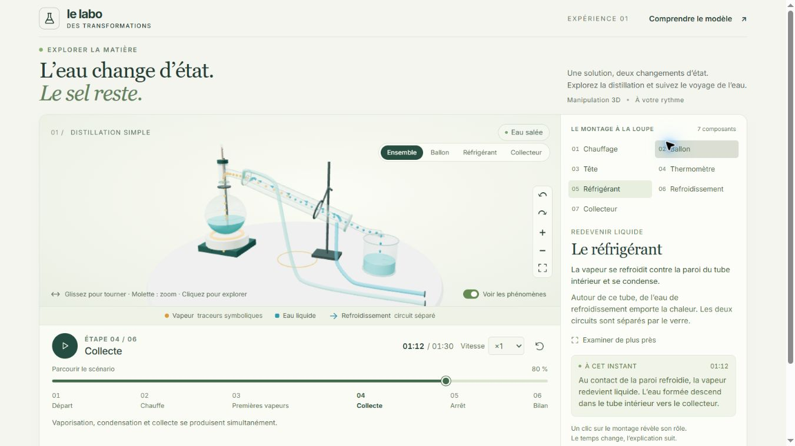

# Distillation Lab

Une expérience pédagogique en français pour comprendre la distillation simple d’eau salée. Explorez un montage en 3D, suivez le trajet de l’eau et découvrez pourquoi le sel reste dans le ballon.

[Installation locale](#installer-et-lancer) · [Architecture](docs/ARCHITECTURE.md) · [Validation](docs/VALIDATION.md) · [Reste à faire](docs/ROADMAP.md)



*Capture réelle du 18 octobre 2026. Les traceurs représentent une vapeur invisible ; leurs couleurs sont pédagogiques. Le projet se lance localement ; aucun site de démonstration n'est proposé.*

## Ce que l’on peut explorer

- Sept composants sélectionnables dans la scène ou dans une liste au clavier, avec leur rôle et leur état à l’instant choisi.
- Rotation, zoom, cadrage limité, quatre vues prédéfinies et recentrage.
- Un scénario de 90 secondes : Départ, Chauffe, Premières vapeurs, Collecte, Arrêt et Bilan.
- Lecture/pause, frise temporelle, sauts d’étapes et vitesses ×0,5, ×1 et ×2.
- Trajets symboliques masquables, circuits de refroidissement et de distillat distincts, sources scientifiques consultables.

La page démarre en pause. Glissez pour tourner, utilisez la molette pour zoomer et cliquez sur un composant pour l’examiner. Au clavier, utilisez les boutons ; lorsque la scène a le focus, les flèches gauche/droite la font tourner et `+`/`-` règlent le zoom. Parcourir la frise ou choisir une étape met en pause sans perdre la sélection ni le cadrage. Le chauffage s’arrête avec une solution saline résiduelle dans le ballon.

## Maturité et choix techniques

**V1 fonctionnelle**, destinée aux débutants sur ordinateur avec WebGL2. Le rendu et les interactions ont été vérifiés dans Chrome et Edge ; les conditions et limites sont détaillées dans la [validation](docs/VALIDATION.md). Les validations mobile, avec lecteur d’écran et auprès d’apprenants restent hors des résultats revendiqués.

HTML, CSS et JavaScript, **Three.js 0.186.1** et **Vite 8.3.4**. La géométrie est créée par code, sans modèle 3D externe. Une fonction pure `stateAt(progress)` reconstruit les niveaux et les phénomènes depuis un instant unique ; la caméra et les commandes restent indépendantes. Ce choix permet de retrouver exactement un état après un déplacement dans le temps. La verrerie transparente, la sélection à travers le verre et la séparation des circuits ont fait l’objet de contrôles dédiés.

Il s’agit d’un scénario qualitatif, sans calcul thermodynamique, mesure expérimentale ni protocole pratique. Les [sources et simplifications](docs/SCIENCE.md) expliquent ces choix. Aucun compte, backend, API payante ou CDN n’est nécessaire à l’expérience.

## Installer et lancer

Prérequis : **Node.js 24.x avec npm**, puis un navigateur de bureau disposant de WebGL2.

```sh
git clone https://github.com/Fares-Knight/distillation-lab.git
cd distillation-lab
npm ci
npm run dev
```

Ouvrir l’adresse affichée par Vite, normalement `http://127.0.0.1:5173`. `npm ci` nécessite Internet ; les dépendances sont verrouillées dans `package-lock.json`. Aucune variable d’environnement ni aucun secret n’est à configurer.

```sh
npm test
npm run build
npm run preview
```

La prévisualisation sert `dist/`, normalement sur `http://127.0.0.1:4173`. Le build inclut les ressources de l’application ; les liens scientifiques externes demandent Internet. Servir `dist/` par HTTP, jamais en ouvrant `index.html` avec `file://`.

Sur le poste Windows d’origine uniquement, `lancer.ps1` utilise une installation Node portable locale non distribuée avec le dépôt. Il ne remplace pas l’installation standard ci-dessus et n’installe rien. Voir les [commandes et le dépannage](docs/ARCHITECTURE.md#commandes-et-dépannage).

## Documentation et licence

- [Architecture et maintenance](docs/ARCHITECTURE.md) : modules, données, configuration, build et déploiement.
- [Validation](docs/VALIDATION.md) : contrôles exécutés, périmètre des preuves et limites.
- [Sources et modèle pédagogique](docs/SCIENCE.md) : correspondance entre affirmations et références.
- [Reste à faire](docs/ROADMAP.md) : dettes, limites et suggestions distinguées des fonctionnalités disponibles.

Le code du projet est publié sous [licence MIT](LICENSE). Les [notices tierces](public/THIRD-PARTY-NOTICES.txt) de Three.js et des helpers générés par les outils de build sont conservées dans le dépôt et dans la distribution. Les documents scientifiques liés restent soumis aux conditions de leurs éditeurs ; ils ne sont pas redistribués ici.
