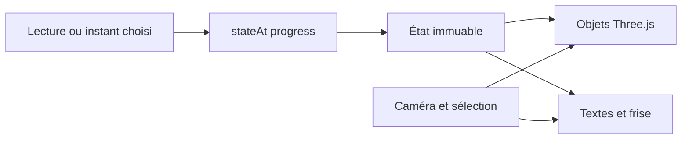

# Architecture et maintenance

Distillation Lab est une page statique en HTML/CSS/JavaScript. Three.js **0.186.1** assure le rendu WebGL2 et Vite **8.3.4** le développement et le build. Les versions exactes sont verrouillées ; l’environnement de validation utilise Node **24.22.0** et npm **11.19.1**.

## Modules et flux de données

| Fichier | Responsabilité |
|---|---|
| [`src/scenario.js`](../src/scenario.js) | Événements, six étapes et fonction pure `stateAt(progress)` |
| [`src/scene.js`](../src/scene.js) | Géométrie procédurale, matériaux, caméra, sélection et application de l’état |
| [`src/main.js`](../src/main.js) | Interface, lecture, commandes et boucle de rendu |
| [`src/content.js`](../src/content.js) | Sept composants, textes contextuels, références et simplifications |
| [`src/style.css`](../src/style.css) | Présentation et disposition de l’interface |
| [`tests/scenario.test.js`](../tests/scenario.test.js) | Invariants temporels et quantités graphiques |

`progress` est normalisé entre 0 et 1. `stateAt` retourne notamment le temps du scénario, l’étape, les intensités de chauffage/refroidissement/vaporisation/condensation/collecte, les fractions graphiques de liquide et le résumé. Les entrées hors bornes sont ramenées aux bornes ; les entrées non numériques et `NaN` produisent l’état initial.

Les positions et visibilités des effets dérivent de cet instant, sans hasard ni accumulation de particules par image. Le volume transféré suit l’intégrale de l’activité de collecte. Les niveaux dessinés résultent de volumes géométriques cohérents ; ils ne constituent pas des mesures expérimentales. La caméra, la sélection, la pause et la vitesse sont séparées de cet état. Le rendu continue en pause pour permettre l’exploration du montage.

La scène assemble des primitives, profils de révolution et conduits. Les trajectoires du distillat et du refroidissement sont distinctes. Les matériaux transparents et les contours privilégient la lisibilité. Le recentrage vide l’inertie restante ; le suivi du geste distingue un clic d’une rotation revenant au point de départ. Pendant la lecture, les textes sont actualisés environ toutes les 80 ms et la scène à chaque image ; la pause synchronise immédiatement l'interface avec le même instant.

## Configuration, données et intégrations

Aucune variable d’environnement applicative, clé, API métier, base de données, authentification ou stockage persistant. Les contenus sont intégrés au build. Les références scientifiques sont des liens externes ouverts à la demande ; aucun modèle ou média distant n’est chargé par la scène.

En développement, `/?qa` affiche un panneau pour capturer le modèle, les objets réellement appliqués, le DOM, la caméra et les erreurs, ou mesurer 30 secondes de temps d’image. Ce panneau n’est pas inclus dans l’interface de production. `/?webgl=off` déclenche volontairement le chemin de repli WebGL ; il ne simule pas une panne matérielle réelle.

## Commandes et dépannage

Depuis une copie du dépôt, avec Node 24.x et npm :

| Commande | Effet |
|---|---|
| `npm ci` | Installe les versions verrouillées ; accès réseau requis |
| `npm run dev` | Serveur local, normalement `127.0.0.1:5173` |
| `npm test` | Tests Node du scénario |
| `npm run build` | Produit `dist/` |
| `npm run preview` | Sert le build, normalement `127.0.0.1:4173` |
| `node scripts/serve-offline.mjs` | Sert une copie en mémoire de `dist/` sur le port 4180 avec ressources distantes interdites par CSP |

Le port affiché par le serveur fait foi. Pour choisir un port : `npm run preview -- --port 4174`. Arrêter avec `Ctrl+C`. Relancer le serveur de contrôle CSP après chaque build : il garde les fichiers en mémoire. Ce contrôle ne déconnecte pas le système d’Internet.

Le script Windows [`lancer.ps1`](../lancer.ps1) est un raccourci **pour le poste équipé de Node portable dans `.tools/`**. Ce dossier et `node_modules/` ne sont pas distribués. Le script accepte `dev`, `test`, `build` et `preview`, restaure le `PATH` et n’installe rien. Si la politique PowerShell le bloque sur ce poste, utiliser `powershell -NoProfile -ExecutionPolicy Bypass -File .\lancer.ps1 dev`, sans modifier la politique globale.

| Symptôme | Action |
|---|---|
| Node portable absent | Utiliser l’installation standard et les commandes npm |
| Dépendances introuvables | Exécuter `npm ci` depuis la racine |
| Prévisualisation indisponible | Exécuter le build, vérifier le port affiché |
| Scène 3D indisponible | Vérifier WebGL2 et l’accélération graphique ; les explications restent accessibles |
| Page ouverte par `file://` | La servir par HTTP avec la prévisualisation |
| Avertissement de taille du bundle | Le build aboutit ; mesurer le chargement avant d’engager une optimisation |

## Vérification et déploiement

Le [rapport de validation](VALIDATION.md) distingue les tests Node des observations navigateur. Aucun script de lint ou de typage n’est actuellement défini. Après une modification du scénario ou de la scène, contrôler les transitions dans les deux sens, le retour 80→20→80 sur les objets/DOM réellement appliqués, la caméra en pause et la sélection ; un build seul ne prouve pas le rendu.

Le workflow [GitHub Actions](../.github/workflows/ci.yml) est configuré pour les push sur `main`, les pull requests et un lancement manuel. Sous Ubuntu avec Node 24, il exécute `npm ci`, `npm test` et `npm run build`. Ses permissions sont limitées à la lecture du contenu et les actions sont fixées à des commits. Le résultat effectif de ses exécutions relève du rapport de validation.

La livraison de ce projet porte sur le code et son utilisation locale, sans démonstration hébergée. Pour une éventuelle réutilisation sur un hébergement statique, seul le contenu de `dist/` doit être servi. Les chemins générés supposent actuellement la racine du domaine ; un sous-chemin nécessite une configuration Vite et une vérification des ressources. Conserver les notices tierces.

Avant une mise à jour des dépendances, examiner les changements, exécuter les tests et le build puis vérifier le rendu dans les navigateurs ciblés. La destruction complète des ressources lors d’une future intégration avec démontage/remontage figure au [reste à faire](ROADMAP.md).
